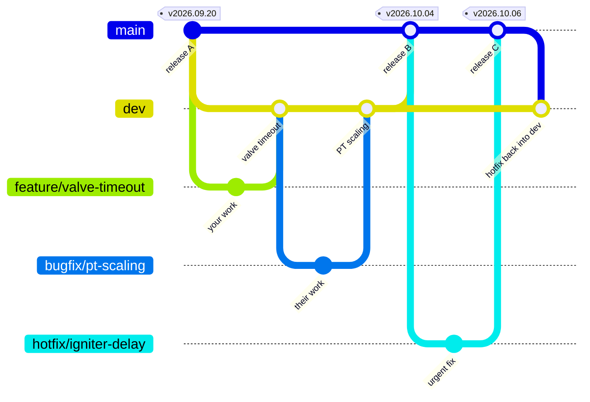

# Contributing to Nova

These rules apply to the Nova code repos: [novaOps-back], [novaOPS-front] and
[novaGround]. This repo (Nova-Collected) uses the simpler GitHub Flow,
described in section 10. The firmware repo belongs to the FAS
team and follows their rules.

> [!IMPORTANT]
> This software commands valves on a real engine. If anything here is unclear,
> ask in the software channel before guessing.

Also read [organization.md](docs/development/organization.md) (where code goes)
and [style.md](docs/development/style.md) (how it's formatted).

[novaOps-back]: https://github.com/UTATRocketry/novaOps-back
[novaOPS-front]: https://github.com/UTATRocketry/novaOPS-front
[novaGround]: https://github.com/UTATRocketry/novaGround

---

## 1. The idea in one picture

Every repo has two permanent branches. Each one matches a stack on the ground
station:

| Branch | Matches | Holds | Who merges into it |
|---|---|---|---|
| `dev` | the **dev** stack, used for hardware tests | new work that is finished but not yet hardware-tested | any member, through a reviewed PR |
| `main` | the **prod** stack, what runs at an engine test | code that passed a hardware test | leads only, through a release or hotfix PR |

Everything else is a short-lived **supporting branch**. You make one for each
piece of work and delete it when it's merged.



Reading it left to right:

1. Features and fixes are branched from `dev` and merged back into `dev`.
2. On a test day, the dev stack runs `dev`, with several new features at once,
   on the real hardware.
3. If it passes, that exact version is released: merged into `main` and
   deployed to prod.
4. An urgent fix for prod is branched from `main`, released, then merged back
   into `dev` so it isn't lost.

---

## 2. The three rules

> [!IMPORTANT]
> 1. **Never commit directly to `main` or `dev`.** Always work on a supporting
>    branch and open a pull request (PR).
> 2. **Your PRs go into `dev`.** Only leads merge into `main`, and normally
>    only code that passed a hardware test.
> 3. **Prod runs releases, not branches.** Code reaches prod when a lead runs
>    `Nova.ps1` on the ground station. The only code edited on the ground
>    station is an emergency fix made by a lead during a test, and it must be
>    turned into a hotfix with `Nova.ps1 hotfix` the same day (section 5).

---

## 3. Branches

### Permanent branches

| | `main` | `dev` |
|---|---|---|
| Purpose | Production: what the prod stack runs | Integration: finished work waiting for a hardware test |
| Changes come from | `dev` (a release) or `hotfix/*` | `feature/*`, `bugfix/*`, `chore/*`, and hotfixes merged back |
| Merged by | leads | anyone, once the PR is approved |
| Merge button | **Create a merge commit** | **Squash and merge** |
| Must always | match what prod runs | build and pass CI |

### Supporting branches

Names follow the [Conventional Branch](https://conventional-branch.github.io/)
spec:

| Prefix | For | Created from | Merged into | Example |
|---|---|---|---|---|
| `feature/` | new capability | `dev` | `dev` | `feature/thermocouple-page` |
| `bugfix/` | a bug fix | `dev` | `dev` | `bugfix/fas-port-reconnect` |
| `chore/` | docs, tests, CI, dependencies, clean-up | `dev` | `dev` | `chore/update-readme` |
| `hotfix/` | urgent fix to prod | `main` | `main`, then `dev` | `hotfix/igniter-delay` |
| `release/` | a tested version on its way to `main` (made by `Nova.ps1`) | a tested commit on `dev` | `main` | `release/v2026.10.04` |

**Naming rules:**

- Use lowercase letters, numbers and hyphens: `feature/valve-timeout`.
- No spaces, capitals, underscores, or double, leading or trailing hyphens.
- Dots only in release versions: `release/v2026.10.04`.
- Keep it short and descriptive. Not `feature/stuff` or `amelia-branch`.

---

## 4. Making a change (everyone)

**Where to work:** in the code repo's clone under the `dev\` folder of your
Nova-Collected clone, e.g. `Nova\dev\backend`.
[Getting started](docs/development/getting-started.md) sets these up. In GitHub
Desktop, add each `dev\` clone with **File → Add local repository**.

> [!WARNING]
> Never work in `prod\` or `pi\`. Those submodules show the released version
> and are overwritten whenever it changes.

This is the normal loop. Steps are shown for **GitHub Desktop** and the
**command line** (run from inside the `dev\` clone).

| Step | GitHub Desktop | Command line |
|---|---|---|
| 1. Start from the latest `dev` | switch to `dev`, then **Fetch origin**, then **Pull** | `git switch dev` then `git pull` |
| 2. Make your branch | **Branch → New branch**, based on `dev` | `git switch -c feature/valve-timeout` |
| 3. Change and test | (see section 7) | |
| 4. Commit | write a summary, then **Commit** | `git add -A` then `git commit -m "..."` |
| 5. Push | **Publish branch** | `git push -u origin feature/valve-timeout` |
| 6. Open a PR **into `dev`** | **Create Pull Request** | open the link git prints |
| 7. Fill in the PR template | | |
| 8. Fix review comments | commit and push again; the PR updates | same |
| 9. Merge | **Squash and merge** once approved and green | |

After merging, switch back to `dev` and pull. The branch is deleted
automatically.

**Before you ask for review:**

- [ ] The PR targets **`dev`**, not `main`.
- [ ] Its title follows the format in section 6.
- [ ] CI is green.
- [ ] The template is filled in: what you changed, how you tested it, and
      whether it affects hardware.
- [ ] Nothing that shouldn't be in git is committed: station
      config/calibrations, data files, passwords, `.env` files, build output.

**Approval:** into `dev`, 1 approval from any team member.

> [!CAUTION]
> **Changes that can move hardware** (actuator commands, safety rules,
> interlocks, timeouts, sequencing) also need a lead's approval. Add the
> `hardware-risk` label.

---

## 5. Getting code to prod (leads)

Releases are made on the ground station with `ops/Nova.ps1`. The full guide,
including hotfixes and rollbacks, is [RELEASING.md](RELEASING.md). In short:

| Step | Command | Result |
|---|---|---|
| Test | `get-changes -Ref dev`, then `use dev` | `dev` runs on the dev stack for the hardware test |
| Record | `pin -Test "..."` | the tested commits and config become a release, e.g. `v2026.10.04` |
| Approve | `promote v2026.10.04` | the release is stable; `publish` opens `release/v2026.10.04` PRs into `main` |
| Deploy | `deploy` | prod runs the newest stable release |

Merge `release/*` and `hotfix/*` PRs into `main` with **Create a merge
commit**. The `release/` branch sits at the commit that was actually tested,
so `main` receives exactly that, even if `dev` has moved on.

**Hotfix:** a fix to prod that can't wait. Branch it from `main`, merge it into
`main`, then back into `dev`. A fix made and tested on the ground station
during a test is captured with `Nova.ps1 hotfix` the same day
([RELEASING.md: Hotfixes](RELEASING.md#hotfixes)).

---

## 6. PR titles and commit messages

PRs into `dev` are squash-merged, so **the PR title becomes the commit message
on `dev`**. The PR title is the one that matters. It follows
[Conventional Commits](https://www.conventionalcommits.org):

```
type(scope): what changed
```

| Type | When |
|---|---|
| `feat` | new capability |
| `fix` | bug fix |
| `refactor` | same behaviour, better code |
| `docs` | documentation only |
| `test` | tests only |
| `chore` | build, CI, dependencies, clean-up |

- `scope` is optional and names the area: `fas`, `mqtt`, `config`, `ui`,
  `daq`, `servo`, `relay`, `pi`.
- Write it as a command, in lowercase, under 72 characters.
- Add `!` if other repos or the station must change to match, for example a
  renamed MQTT topic: `feat(mqtt)!: rename telemetry topic`.

Examples:

- `feat(ui): add thermocouple trend plot`
- `fix(fas): reopen the COM port after the adapter is unplugged`
- `docs: explain the hotfix steps`

The commits inside your branch can be messy ("wip", "try again"), because they
are squashed away. Clear messages still help your reviewer.

> [!NOTE]
> Your PR title is also your entry in the repo's `CHANGELOG.md`, which is
> generated from these titles after each release ([RELEASING.md](RELEASING.md#changelog)).
> Write it for someone reading the release history.

---

## 7. Testing

### Testing levels

Each level includes everything from the levels above it.

| Level | Name | What it is | Hardware | Who runs it |
|---|---|---|---|---|
| 1 | **Unit / Automated Test** | Unit tests and builds, run automatically by CI on every push | none | CI |
| 2 | **Simulator Test** | Go through the testing procedure with hardware simulators in place of the real hardware | none: simulators only | you |
| 3 | **Bench Test** | Go through the testing procedure on at least the dev stack; possibly the full EGSE and some real hardware | some | you, with a lead to set up the bench |
| 4 | **Integration Test** | Go through the full engine test procedure with the real hardware, but no propellants | all, unpressurised | leads, on a test day |
| 5 | **Engine Test** | A completed engine test: cold flow, hot fire, or launch ops rehearsal | all, live | the whole team; stable releases only |

The [**testing procedure**](docs/development/testing-procedure.md) is the
hands-on part of levels 2 and 3. You open
the UI and actually use it, going through everything that needs checking, and
for each step it says how you know it worked.

- **Simulators** need no hardware: `tools/novaMock.py` and
  `tools/nova_dummy.py` in the backend, and `./run.sh --target novaMock` on
  novaGround.
- **Bench:** ask a lead to put your branch on the dev stack with
  `Nova.ps1 get-changes -Ref <your branch>`.

### How far a change must go

| Your change touches... | Before merging into `dev` | Before it goes to `main` |
|---|---|---|
| Docs only | 1 Unit / Automated | 1 Unit / Automated |
| UI layout, tooling | 2 Simulator | 3 Bench |
| How sensors are read, converted or shown | 2 Simulator | 4 Integration |
| How actuators are commanded, safety rules, interlocks, timing (`hardware-risk`) | 2 Simulator, plus 3 Bench if a lead can set it up | 4 Integration |
| Message formats or topics shared between repos | 2 Simulator, with all repos' PRs together | 4 Integration |

The "before `main`" column is normally met on a test day, which tests
everything merged into `dev` together. Only a stable release is ever used for
an Engine Test.

---

## 8. Avoiding merge conflicts

1. **Keep branches small and short-lived.** Aim to merge within a week.
2. **Update your branch from `dev` often.** Use the **Update branch** button on
   the PR.
3. **One topic per branch.** Don't reformat code you aren't changing.
4. **Don't change backend config in git.** Calibrations are edited in the web
   interface on the ground station and saved outside git. Change
   `config/*.yaml` in the backend only to change the published defaults, and
   in its own PR.
5. **If a conflict confuses you, stop and ask.** Don't click "accept all" to
   make it go away.

`main` only changes through releases and hotfixes, and hotfixes are merged
back into `dev`, so merging `dev` into `main` should never conflict.

---

## 9. Never

> [!CAUTION]
> These can break the ground station, lose a release, or leak a password.

- Push directly to `main` or `dev`.
- `git push --force` on a branch someone else uses.
- Edit code in `C:\Nova\prod\` on the ground station or in the Pi's prod
  folder, except for a lead's emergency fix during a test, captured with
  `Nova.ps1 hotfix` the same day. `deploy` refuses to run over uncaptured
  edits.
- Make changes in the `prod\` or `pi\` submodules of your own clone. Use the
  `dev\` clones (section 4).
- Commit passwords, tokens or keys. The real admin password goes in the
  ground station's own `ops\nova.settings.ps1`, which is never committed.
- Make changes in or commit to the firmware repo; it is for reference only.

---

## 10. This repo (Nova-Collected)

On GitHub this repo is **Nova-Collected**. On the ground station it's cloned
as `C:\Nova`, and the docs call it "the Nova repo". This repo holds three
things:
- the ground station's scripts (`ops/`);
- the **pins**: which commit of each code repo belongs together;
- the record of every release (`releases/`).

It uses **GitHub Flow**, which is simpler than the code repos' model. There's
just `main`, plus short-lived branches:

| | |
|---|---|
| `main` | what the ground station runs: its scripts, and the release history `Nova.ps1` records |
| Supporting branches | `feature/`, `bugfix/` and `chore/`, created from `main`, PR'd back into `main` |

There's no `dev` branch here, because the code repos' `dev` branches already
hold the next set of code changes. `Nova.ps1` never changes which branch this
repo is on; `use dev` only switches the stacks.

### Changing the scripts or docs

1. Branch from `main`, e.g. `feature/status-shows-pi-release`, and push it.
2. **To try it on the ground station,** switch `C:\Nova` to your branch by
   hand, test, and switch back:

   ```powershell
   git -C C:\Nova switch feature/status-shows-pi-release
   # ...try it...
   git -C C:\Nova switch main
   ```

   While `C:\Nova` is on another branch, `pin`, `promote`, `hotfix` and
   `publish` refuse to run. They write release history, which must land on
   `main`. `status` shows which branch the scripts are on.
3. Open a PR into `main`. `ops/` changes need a lead's approval, because they
   run the ground station.
4. Merge it by hand once approved, with **Squash and merge**. Then pull on the
   ground station (`git -C C:\Nova pull`), or let the next `publish` merge it
   in.

**Never change `prod/`, `pi/`, `firmware` or `releases/` by hand.** Only
`Nova.ps1` does, by committing straight to `main` on the ground station. CI
rejects PRs that try.

> [!IMPORTANT]
> Never commit `ops\nova.settings.ps1`. It holds the real admin password.

**Settings: the example and the real file.**
- `ops/nova.settings.example.ps1` is tracked. It's the reference: the default
  value of every setting. Change a default, or add a new setting, through a PR
  like any other file.
- `ops\nova.settings.ps1` is each machine's own copy, and the only file
  `Nova.ps1` reads. It's never committed, so it holds the real admin password
  and that PC's COM port, and can be edited in place on the ground station.
  `Nova.ps1` creates it from the example the first time it runs.
- If the example later gains a setting that a machine's copy doesn't have,
  `Nova.ps1` uses the example's value and warns until you copy it across.
  `doctor` lists any missing settings.

---

## Words used here

Branch, PR, squash and merge, CI, dev and prod stack, release, pin, promote,
deploy, hotfix: see the [glossary](docs/misc/glossary.md#contributing-terms).
