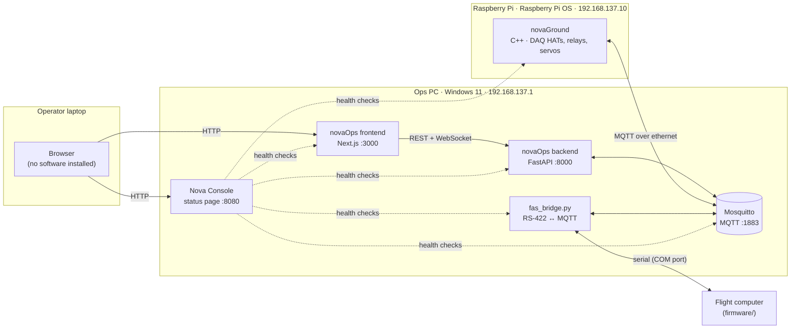

# Nova-Collected

The single place to get, run, and understand the Nova ground station.

Nova is three pieces of software that run at the same time on two machines,
talking to a flight computer whose firmware is maintained by a different team.
This repo ties them together:

- **Submodules** pin one commit of each repo. A commit of Nova-Collected is a
  set of versions that are known to work together, including the firmware they
  were tested against.
- **`ops/`** holds the scripts that install, start, stop, update, and monitor
  the stack (`Nova.ps1` and the Nova Console).

If you are an operator and just need to bring the stack up, go straight to
[ops/README.md](ops/README.md).

---

## How the system fits together



All three machines sit on the same ethernet switch with static IPs
(see [ops/README.md §6](ops/README.md#6-ip-addresses-ethernet-only)).

MQTT is the backbone. novaGround and the FAS bridge both **publish telemetry**
(`nova/telemetry/...`) and **subscribe to commands** (`nova/command`); the
backend sits in between and serves the operator UI.

## What's in here

| Path | Repo | Runs on | What it is |
|---|---|---|---|
| [`novaGround/`](https://github.com/UTATRocketry/novaGround) | submodule | Raspberry Pi | C++ hardware control: reads DAQ HATs, drives relays and servos, talks MQTT. Built with meson, run by systemd. |
| [`novaOps/backend/`](https://github.com/UTATRocketry/novaOps-back) | submodule | Ops PC | Python/FastAPI server. Also contains `tools/fas_bridge.py`, the serial ↔ MQTT bridge to the flight computer. |
| [`novaOps/frontend/`](https://github.com/UTATRocketry/novaOPS-front) | submodule | Ops PC | Next.js operator UI. |
| [`firmware/`](https://github.com/UTATRocketry/Gigafloss-FAS-Firmware-and-Server) | submodule | Flight computer | **Reference only, owned by the FAS team.** Pinned to the version the other three are compatible with. Do not commit here. |
| `ops/Nova.ps1` | this repo | Ops PC | Installs and controls every Windows service. |
| `ops/nova.config.ps1` | this repo | Ops PC | **Single source of truth** for paths, ports, IPs, COM port. |
| `ops/console/` | this repo | Ops PC | Nova Console: stdlib-only Python status page. |
| [`ops/README.md`](ops/README.md) | this repo | — | Operations runbook: start/stop, troubleshooting, IPs, laptop setup. |

The Pi has its own control script, `novaGround/nova-pi.sh`, which lives in the
novaGround repo because it's deployed with it.

### Currently pinned

| Submodule | Tracks branch | Pinned commit |
|---|---|---|
| novaGround | `code_refactoring` | `84d1be6` |
| novaOps/backend | `fas_integration` | `92fb376` |
| novaOps/frontend | `fas_refactor` | `09e64d7` |
| firmware | `main` | `ae5b4fd` |

`git submodule status` always gives the live answer; update this table when you
bump a pin.

---

## Getting started

```bash
git clone --recursive https://github.com/UTATRocketry/Nova-Collected.git
cd Nova-Collected
```

Already cloned without `--recursive`?

```bash
git submodule update --init --recursive
```

Each submodule is checked out at its pinned commit in *detached HEAD*. That is
expected: you're looking at the exact version that was tested. To work on one,
check out its branch first (see below).

Then read, in this order:

1. This file, for the big picture.
2. [ops/README.md](ops/README.md), for how the stack is run.
3. The README of whichever repo you'll be working in.
4. `firmware/FMC-Interface-Contract.md` if you're touching anything that talks
   to the flight computer.

---

## Everyday workflows

### Pull the latest known-good set

```bash
git pull
git submodule update --init --recursive
```

Tip: `git config --global submodule.recurse true` makes plain `git pull` and
`git checkout` update submodules automatically.

### Work on one of the repos

Submodules are ordinary git repos. Commit and push inside them as usual:

```bash
cd novaOps/backend
git switch fas_integration
# ...edit, commit...
git push
```

Then record the new commit here, so everyone else gets it:

```bash
cd ../..
git add novaOps/backend
git commit -m "Bump backend: <what changed>"
git push
```

Always push the submodule **before** pushing Nova-Collected. Otherwise the pin
points at a commit nobody else can fetch. `git push --recurse-submodules=check`
refuses to push if you forget.

### Bump every pin to the tip of its tracked branch

```bash
git submodule update --remote
git submodule status          # review what moved
git add -A && git commit -m "Bump submodules"
```

This pulls the branches listed in `.gitmodules`. Only do this once you've
checked that the combination actually works on the bench.

### Change which branch a submodule tracks

```bash
git config -f .gitmodules submodule.novaOps/backend.branch main
git submodule update --remote novaOps/backend
git add .gitmodules novaOps/backend
git commit -m "Track backend main"
```

### Update the firmware reference

When the FAS team releases firmware you've tested against:

```bash
cd firmware && git fetch && git checkout <their commit or tag> && cd ..
git add firmware
git commit -m "Pin firmware <version>: compatible with current novaOps/novaGround"
```

Before bumping, diff `firmware/gs/protocol.py` against the previous pin.
`novaOps/backend/tools/fas_bridge.py` re-implements that wire protocol (it does
not import it), so protocol changes there need a matching change in the bridge.

### Mark a version you flew or tested with

```bash
git tag -a test-2026-10-04 -m "Static fire, all systems nominal"
git push --tags
```

A tag on Nova-Collected records all four versions at once, so anyone can check
out exactly what ran that day.

---

## Deploying

The ops PC and Pi run from their own clones at fixed paths (set in
`ops/nova.config.ps1` and `novaGround/nova-pi.sh`):

| Machine | Env | Path |
|---|---|---|
| Ops PC | prod | `C:\Nova\prod\novaOps-back`, `C:\Nova\prod\novaOPS-front` |
| Ops PC | dev | `C:\Nova\dev\novaOps-back`, `C:\Nova\dev\novaOPS-front` |
| Pi | prod | `/home/admin/prod/novaGround` |
| Pi | dev | `/home/admin/dev/novaGround` |

Full setup and every command are in [ops/README.md](ops/README.md). Run
`ops\Nova.ps1` from a clone of **this** repo. It finds `nova.config.ps1` and
the console next to itself, and finds the backend/frontend through the paths in
the config.

To deploy the pinned versions rather than branch tips, check out the commit
shown by `git submodule status` in each deployment clone:

```powershell
git -C C:\Nova\prod\novaOps-back checkout 92fb376
```

---

## Repo history

Earlier versions of this repo also pinned `daqhats` and used `update.sh`
with Docker. daqhats is now installed by `novaGround/install.sh`, and the
Docker/tmux workflow has been replaced by Windows services (`ops/Nova.ps1`)
and systemd (`nova-pi.sh`).
