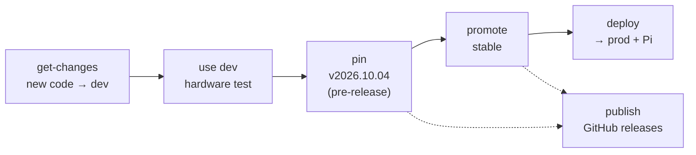

# Nova GCS

The single place to get, run, version and understand the Nova Ground Control System software.
On GitHub it's [`Nova-Collected`](https://github.com/UTATRocketry/Nova-Collected).
On the ops PC it's cloned as `C:\Nova`, which is why the docs call it "the
Nova repo" and give paths like `C:\Nova\ops`.

Nova is three pieces of software that run at the same time on two machines,
talking to a flight computer whose firmware is maintained by a different team.
This repo ties them together:

- **Submodules** pin one commit of each repo. Each **release**
  (`v2026.10.04`) is a set of versions that passed a hardware test together,
  along with the config they were tested with and the firmware they are
  compatible with.
- **`ops/`** holds `Nova.ps1`, which tests, pins, deploys and operates the
  stack, and the Nova Console status page.

If you are an operator and just need to bring the stack up, go straight to
[ops/README.md](ops/README.md).

---

## How the system fits together


All three machines sit on the same ethernet switch with static IPs
(see [ops/README.md §6](ops/README.md#6-ip-addresses-ethernet-only)).

MQTT is the backbone. novaGround and the FAS bridge both **publish telemetry**
(`nova/telemetry/...`) and **subscribe to commands** (`nova/command`); the
backend sits in between and serves the operator UI.

---

## What's in here

The repo layout is the NovaOps server's layout. Tracked folders sit beside the
server's own, untracked ones:

```
C:\Nova\                       (this repo, Nova-Collected)
├── ops\                       Nova.ps1, nova.settings.example.ps1, console, runbook
├── prod\
│   ├── backend\               submodule: novaOps-back + fas_bridge } run exactly
│   └── frontend\              submodule: novaOPS-front (UI)        } what's pinned
├── pi\novaGround\             submodule: Pi software (empty on the server)
├── firmware\                  submodule: FAS firmware, reference only
├── releases\<tag>\            what each release pinned + the config it was tested with
├── docs\                      documentation
│
├── dev\                       ┐ never committed (.gitignore):
│   ├── backend\               │   your own clones of the code repos -
│   ├── frontend\              │   where you make changes (on the server,
│   └── novaGround\            │   the dev stack runs from them)
├── config\  data\  archive\   │ live config + history, recordings, bundles
├── logs\  bin\  state\        │ service logs and binaries
├── ops\nova.settings.ps1      │ this machine's settings (from the example)
└── console.json  releases.json┘
```

| Path | Runs on | What it is |
|---|---|---|
| [`prod/backend`](https://github.com/UTATRocketry/novaOps-back) (novaOps-back) | Ops PC | Python/FastAPI server. Also contains `tools/fas_bridge.py`, the serial ↔ MQTT bridge to the flight computer. |
| [`prod/frontend`](https://github.com/UTATRocketry/novaOPS-front) (novaOPS-front) | Ops PC | Next.js operator UI. |
| [`pi/novaGround`](https://github.com/UTATRocketry/novaGround) | Raspberry Pi | C++ hardware control: reads DAQ HATs, drives relays and servos, talks MQTT. Built with meson, run by systemd, managed by its own `nova-pi.sh`. |
| [`firmware`](https://github.com/UTATRocketry/Gigafloss-FAS-Firmware-and-Server) | Flight computer | **Reference only** Firmware for the STM32 boards in the FAS. Pinned to the version that Nova is compatible with. Do not commit here. |
| `ops/Nova.ps1` | Ops PC | Every NovaOps command: get-changes, use, pin, promote, deploy, publish, install, status... |
| `ops/nova.settings.ps1` | Ops PC | **The** settings file `Nova.ps1` reads: paths, ports, IPs, COM port, admin password. This machine's own copy, never committed. Created from the example the first time `Nova.ps1` runs, like `.env` from `.env.example`. |
| `ops/nova.settings.example.ps1` | - | The tracked reference settings. Change defaults or add settings here, through a PR. |
| `ops/console/` | Ops PC | Nova Console: stdlib-only Python status page, and the release lookup the Pi uses. |

On the Pi, novaGround lives in its own clones at `/home/admin/prod/novaGround`
and `/home/admin/dev/novaGround`. The PC reads and deploys them over SSH.

---

## How a new version reaches prod



```powershell
.\ops\Nova.ps1 get-changes -Ref dev               # the dev branch onto the dev stack
.\ops\Nova.ps1 use dev                            # prod off, dev on - run the test
.\ops\Nova.ps1 pin -Test "integration test" -Notes "all valves cycled"
.\ops\Nova.ps1 promote v2026.10.04                # once it's proven stable
.\ops\Nova.ps1 deploy                             # newest stable -> prod and the Pi
.\ops\Nova.ps1 publish                            # when online
```

Everything except `publish` works offline. Tested versions are recorded as
**pre-releases** and stable ones as **releases** on the repo's GitHub Releases
page, each with what was tested, notes, the exact commits, links to what changed,
and the config used. To go back to any earlier version:

```powershell
.\ops\Nova.ps1 deploy v2026.09.12
```

Full command reference: [ops/README.md §3](ops/README.md#3-command-reference).

### Control configs and Data recordings

Live config (calibrations edited in the web interface) lives in
`C:\Nova\config\<env>\`, outside the code. Every save is kept automatically in
`config\history\`, identified by content hash, so no commits are needed.

Each recording gets a `.meta.json` naming the exact config its raw data was
taken with. `archive` turns each finished recording into a self-contained
bundle in `archive\` (data, config and metadata together). Uploading bundles to
the shared Google Drive is planned.

---

## Getting started as a developer

Clone this repo, then clone the code repos you'll work on into its `dev\`
folder:

```bash
git clone --recursive https://github.com/UTATRocketry/Nova-Collected.git Nova
cd Nova
git clone -b dev https://github.com/UTATRocketry/novaOps-back.git dev/backend
git clone -b dev https://github.com/UTATRocketry/novaOPS-front.git dev/frontend
git clone -b dev https://github.com/UTATRocketry/novaGround.git dev/novaGround
```

The folder name `Nova` is a convention: it matches `C:\Nova` on the server.
Any name works on your own computer.

**Make your changes in the `dev\` clones, never in `prod\` or `pi\`.** The
submodules in `prod\`, `pi\` and `firmware\` are each checked out at the
commit of the newest release, in *detached HEAD*: they show what's released,
and they're overwritten whenever it changes. The `dev\` clones are ordinary
repos on the `dev` branch, where you branch, commit and push (section
"Work on one of the repos" below). `dev\` is ignored by this repo, so nothing
you do there shows up here.

Then read, in this order:

1. This file, for the big picture.
2. [CONTRIBUTING.md](CONTRIBUTING.md), for branches, commits and PRs:
   **required before your first PR.**
3. [ops/README.md](ops/README.md), for how the stack is run and updated.
4. The README of whichever repo you'll be working in.
5. `firmware/FMC-Interface-Contract.md` if you're touching anything that talks
   to the flight computer.

---

## Everyday workflows

### Pull the latest known-good set

```bash
git pull
git submodule update --init --recursive
```

Tip: `git config --global submodule.recurse true` makes plain `git pull` and
`git checkout` update submodules automatically.

### Work on one of the repos

Work in that repo's clone under `dev\`, on a branch made from `dev`, and open
a PR into `dev`. The full rules are in [CONTRIBUTING.md](CONTRIBUTING.md).

```bash
cd dev/backend
git switch dev && git pull
git switch -c bugfix/fas-port-reconnect
# ...edit, commit...
git push -u origin bugfix/fas-port-reconnect    # then open the PR into dev
```

Once your PR is merged into `dev`, it reaches prod when a test day tests
`dev`, `Nova.ps1 pin` records it, and a lead releases it to `main`. Nothing
changes in this repo until then.

### Bumping pins and tracked branches

Not done by hand any more:

- **Pins** move only with `Nova.ps1 pin`, which records exactly what the dev
  stack ran on hardware.
- **Tracked branches:** the submodules here track `main`, which is what prod
  runs.

### Updating the firmware reference

When the FAS team releases firmware you've tested against, record it with the
next pin:

```powershell
git -C firmware fetch
.\ops\Nova.ps1 pin -Test "..." -Firmware <their commit or tag>
```

Before doing so, diff `firmware/gs/protocol.py` against the previous pin.
The backend's `tools/fas_bridge.py` re-implements that wire protocol (it
does not import it), so protocol changes there need a matching change in the
bridge.

---

## Repo history

This repo used to pin `daqhats` as well, and used
`update.sh` with Docker. daqhats is now installed by `novaGround/install.sh`, and
the Docker/tmux workflow has been replaced by Windows services (`ops/Nova.ps1`)
and systemd (`nova-pi.sh`).
