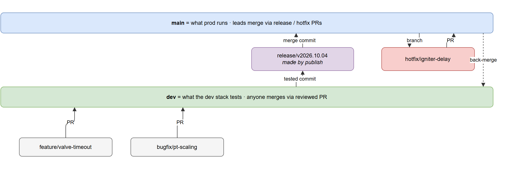
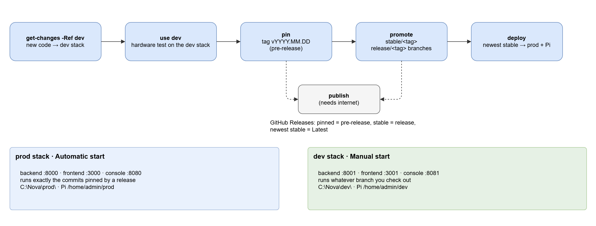

# Releasing

How a version of Nova gets from `dev` to the prod stack: the release model, the
workflow, and the commands. Every step runs on the ops PC with
[`ops/Nova.ps1`](ops/README.md).

**What this document answers**

- What a release is, and what pinned, stable and deployed mean
- How to test, pin, promote, deploy and publish a version
- How to make a hotfix and how to roll back
- Why the release commands behave the way they do

> [!IMPORTANT]
> Releasing is done by leads, from an **elevated** PowerShell in `C:\Nova`, on
> `main`. While `C:\Nova` is on any other branch, `pin`, `promote`, `hotfix`
> and `publish` refuse to run.

## The model

There are three kinds of state on the ground station. Each lives in exactly one
place and is changed by exactly one kind of action.

| State | Where | Changed by | Versioned by |
|---|---|---|---|
| **Code** | `prod/`, `dev/`, the Pis | `get-changes`, `deploy` | git, pinned by this repo (novaGround only; other Pis are recorded) |
| **Station config** | `C:\Nova\config\<env>\` | the web interface | automatic content-hash history ([configs.md](docs/architecture/configs.md)) |
| **Recordings** | `C:\Nova\data\<env>\` | the loggers | `.meta.json` per recording, bundled by `archive` |

Code checkouts never contain live station state, so switching versions can't
lose a calibration.

### Releases

A **release** is one commit of this repo, tagged `vYYYY.MM.DD` (`.2`, `.3`, ...
for a second release on the same day). It pins:

- the backend and frontend commits the dev stack was running;
- the novaGround commit the novaGround Pi's dev checkout was running (read over SSH);
- the firmware commit it's compatible with (reference only).

The other Pis (novaThermo) aren't pinned. `pin` records what each was running
in `release.json` under `ranWith`, and the release notes say when it differs
from novaGround. [design/pi-orchestration.md](docs/design/pi-orchestration.md)
explains why.

It also adds `releases/<tag>/`:

- `release.json`: what was tested, notes, who pinned it, the pins, and the
  recordings made since the previous release;
- `config/`: the config files the test ran with, byte for byte.

A release moves through three states:

| State | Meaning | Made by | On GitHub Releases |
|---|---|---|---|
| **pinned** | passed a hardware test | `pin` (tag `vYYYY.MM.DD`) | pre-release |
| **stable** | fit for prod | `promote` (adds tag `stable/vYYYY.MM.DD`) | release; the newest is **Latest** |
| **deployed** | what prod is running now | `deploy` | - |

Pinned and stable are separate because a version can pass its test and still be
an intermediate step you wouldn't fly. Both are plain git tags, so everything
except `publish` works offline. Once published, each release is added to the
changelogs automatically ([Changelog](#changelog)).

### Branches and releases

Each code repo has two permanent branches that mirror the two stacks
([CONTRIBUTING.md §1](CONTRIBUTING.md#1-the-idea-in-one-picture)): `dev` is
what the dev stack tests and `main` is what prod runs.



- `pin` records whatever the dev checkouts are running, normally `dev`. Any
  branch is allowed, but if it isn't `dev`, `main`, `hotfix/*` or `release/*`,
  `pin` and `promote` warn and the release notes say so.
- `publish`, for the newest stable release, creates a `release/<tag>` branch in
  each code repo at the exact tested commit and opens its PR into `main`.
  `dev` may have moved on since the test, so the release branch makes sure
  `main` receives what was tested and nothing newer.
- `publish` also tags every pinned commit in its own repo as `nova/<tag>`.
  Squash merges and deleted branches would otherwise let a pinned commit
  disappear from GitHub.
- `deploy` deploys releases, never branch tips.

## Releasing a version



### 1. Put the code on the dev stack

```powershell
.\ops\Nova.ps1 get-changes -Ref dev
```

This fetches, checks out `-Ref`, fast-forwards, and reinstalls and rebuilds
dev. To try one open PR's branch on its own, name it and limit it to its repo:

```powershell
.\ops\Nova.ps1 get-changes -Ref bugfix/fas-port-reconnect -Only backend
```

It does the same for every Pi's dev checkout over SSH, and builds it. Pass
`-PiRef <branch>` to switch the Pis to another novaGround branch.

### 2. Test on hardware

```powershell
.\ops\Nova.ps1 use dev
```

This stops prod and starts dev, on the PC and on every Pi (`novaGround@prod`
stops and `novaGround@dev` starts). It also rewrites each Pi's settings, so
the Pis upload to dev's backend. The dev UI is on port 3001.

Run the Integration Test ([CONTRIBUTING.md §7](CONTRIBUTING.md#7-testing)), then
switch back:

```powershell
.\ops\Nova.ps1 use prod
```

### 3. Pin what you tested

```powershell
.\ops\Nova.ps1 pin -Test "integration test" -Notes "All valves cycled; PGSO drift noted"
```

This records the commits, novaGround's commit, what the other Pis ran, and the
dev config as a new release
such as `v2026.10.04`, and bundles the test's recordings
into `C:\Nova\archive`.

> [!NOTE]
> `pin` refuses if a tested checkout has uncommitted changes, or if `dev` or
> `main` has local commits that aren't on GitHub. Both would make the release
> impossible to check out again.

| Situation | Flag |
|---|---|
| The novaGround Pi is unreachable | `-GroundCommit <full hash> -GroundBranch dev`, or `-SkipPi` to keep the current novaGround pin |
| New FAS firmware has been released and tested against | `-Firmware <commit or tag>` ([procedure](docs/maintenance/update-the-firmware-reference.md)) |

### 4. Promote it to stable

Once the release has earned it:

```powershell
.\ops\Nova.ps1 promote v2026.10.04
```

### 5. Deploy it to prod

```powershell
.\ops\Nova.ps1 deploy
```

This deploys the newest stable release: it checks out the pinned commits in
`prod\`, reinstalls, restarts, deploys novaGround over SSH, and puts every Pi
on prod. It always prints the novaGround commit, so you can do the Pi step by
hand (`sudo ./nova-pi.sh deploy <tag or commit>`).

novaThermo keeps its code: it isn't part of the release. To put it on what it
ran with during the test, add `-AlsoDeploy NovaThermo`.

`deploy` compares prod's live config with the tested config. Add `-WithConfig`
to switch prod to the tested config; the old one is kept in the config history.

### 6. Publish when online

```powershell
.\ops\Nova.ps1 publish -DryRun   # see what it would do
.\ops\Nova.ps1 publish
```

This pushes the pins and tags, creates or updates the GitHub releases, and
pushes the `release/<tag>` branches and opens their PRs into `main`. Merge each
of those PRs with **Create a merge commit**.

> [!TIP]
> If `publish` says a pinned commit is "not on GitHub yet", run the `git push`
> it prints, then publish again.

## Hotfixes

A hotfix is always branched from `main` (what prod runs), merged into `main`,
then merged back into `dev` so the fix isn't lost.

### On-site hotfix

Sometimes the fastest safe fix is a small edit on the ground station, tested
right away on the prod stack. Capture it **the same day**:

```powershell
.\ops\Nova.ps1 hotfix -Name igniter-delay -Test "integration test, igniter re-run"
```

This creates `hotfix/igniter-delay` in every prod checkout with edits (PC and
the novaGround Pi) from the release prod was running, commits the edits there, and records the
result as a new release that's **stable at once**, since prod already runs it.
The next `publish` opens the hotfix PRs into `main` and, once they're merged,
the back-merge PRs into `dev`.

> [!WARNING]
> `deploy` refuses to run over uncaptured edits in `prod\`. If the Pi was
> edited, push its hotfix branch from the Pi; `hotfix` prints the command.

### Planned hotfix

Branch `hotfix/<name>` from `main` yourself and fix it like any other branch.
Then test it on the dev stack (`get-changes -Ref hotfix/<name>`), `pin`,
`promote`, PR into `main`, and `deploy`. Merge `main` back into `dev`
afterwards.

## Rolling back

Every release stays deployable:

```powershell
.\ops\Nova.ps1 deploy v2026.09.20
```

A pre-release also needs `-AllowPrerelease`. `ops/` itself always runs from
`main`, so a rollback changes the code prod runs, not the tooling. If the
rollback is permanent, fix `main` afterwards with a hotfix or a revert.

## When the normal path doesn't fit

These are the normal rules, not an absolute law. A lead may pin a branch other
than `dev`, or merge into `main` without a full hardware test (for example a
docs-only change). Say why in the release notes or the PR.

## Changelog

Each repo's `CHANGELOG.md` is generated by [git-cliff](https://git-cliff.org)
in a GitHub Actions workflow (`.github/workflows/changelog.yml`, configured by
`cliff.toml`). Nothing on the ground station is involved.

| Repo | Runs when | Lists | Opens a PR into |
|---|---|---|---|
| Nova-Collected | `publish` pushes a release tag | this repo's changes, plus each pin or hotfix | `main` |
| backend, frontend, novaGround | a release or hotfix is merged into `main` | the PRs merged since the previous release, grouped by type | `dev` |

The code repos find each release through the `nova/<tag>` tags that `publish`
puts on the pinned commits. Entries come from PR titles, which is why they
follow Conventional Commits ([CONTRIBUTING.md §6](CONTRIBUTING.md#6-pr-titles-and-commit-messages)):
`feat` becomes **Features**, `fix` becomes **Fixes**, and so on.

The workflow can't push to protected branches, so it opens (or updates) a
`chore/update-changelog` PR titled `docs(changelog): update changelog`. Review
it like any docs PR and merge with **Squash and merge**. To rebuild a changelog
at any time, run the `changelog` workflow from the repo's **Actions** tab.

> [!IMPORTANT]
> **One-time setup, in each repo:**
> 1. **Settings → Actions → General → Workflow permissions:** tick **Allow
>    GitHub Actions to create and approve pull requests**. Without it, the
>    workflow can't open its PR.
> 2. **Recommended:** add a repo secret `CHANGELOG_TOKEN`, a fine-grained token
>    (or GitHub App token) with **Contents** and **Pull requests** read and
>    write on that repo. GitHub doesn't run workflows for PRs opened with the
>    built-in token, so without this secret the changelog PR's required checks
>    never start and a lead has to merge it as an admin.

## How it works

### This repo's own branches

This repo uses GitHub Flow: `main` plus short-lived branches
([CONTRIBUTING.md §10](CONTRIBUTING.md#10-this-repo-nova-collected)).
`Nova.ps1` commits release records and pins straight to `main` on the ground
station.

- `publish` **merges** `origin/main` into the station's `main` before pushing,
  never rebases. A rebase would move pin commits out from under their tags.
- CI rejects PRs that touch `prod/`, `pi/`, `firmware`, `.gitmodules` or
  `releases/`, so a PR can never conflict with a pin.

### Why pins are written with `update-index`

`pin` writes each submodule commit straight into the index instead of checking
it out, because the Pi's commit never exists on the PC and prod's checkouts
must only move when `deploy` says so.

> [!NOTE]
> As a result, `git status` in `C:\Nova` shows `prod/*` as modified whenever
> prod isn't on the newest pin. That's expected. `Nova.ps1 status` shows what
> prod actually runs.

### Offline

Every pinned commit came from a dev checkout, which already has it. When
`deploy` (PC) or `nova-pi.sh deploy` (Pi) can't fetch a commit from GitHub, it
fetches it from the dev checkout on the same machine. `publish` refuses to push
a release whose pinned commits aren't on GitHub yet, since nobody else could
check it out.

### Why it was built this way

Before this design, one person pulled code into the dev folders, tested, then
stashed prod's local config, checked out the tested commits and restored the
stash. Nothing recorded which versions had been tested, how, or with which
calibration, and rolling back meant remembering. This model records all three
and works offline.
