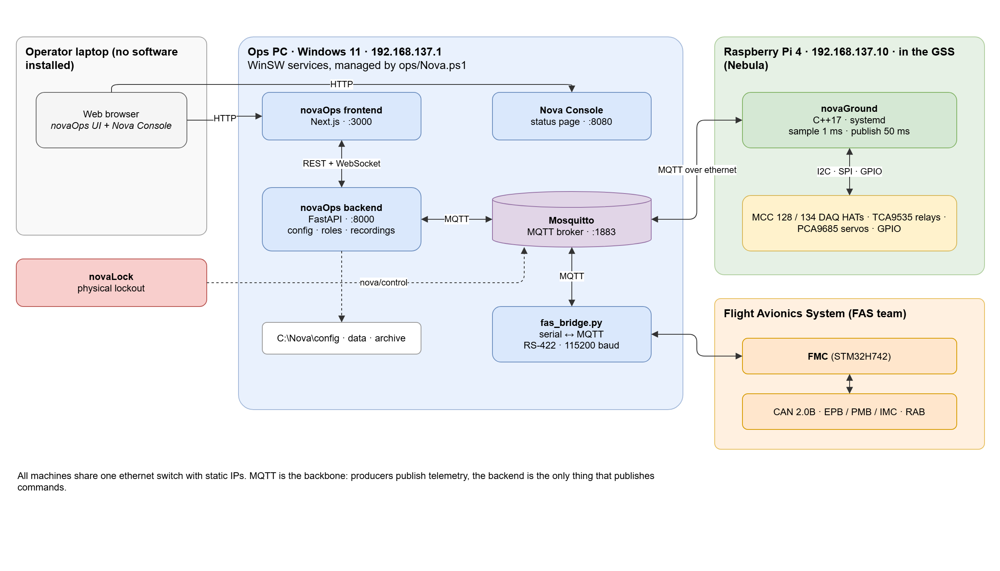
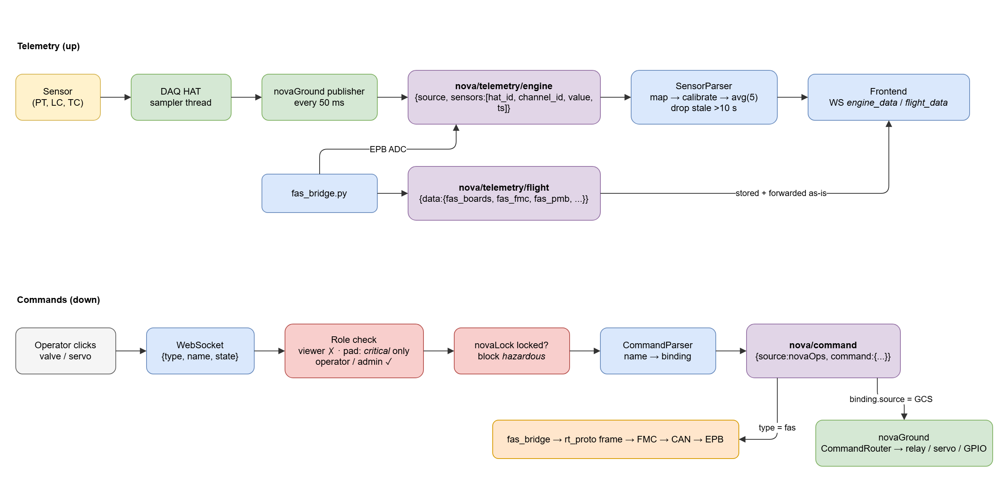
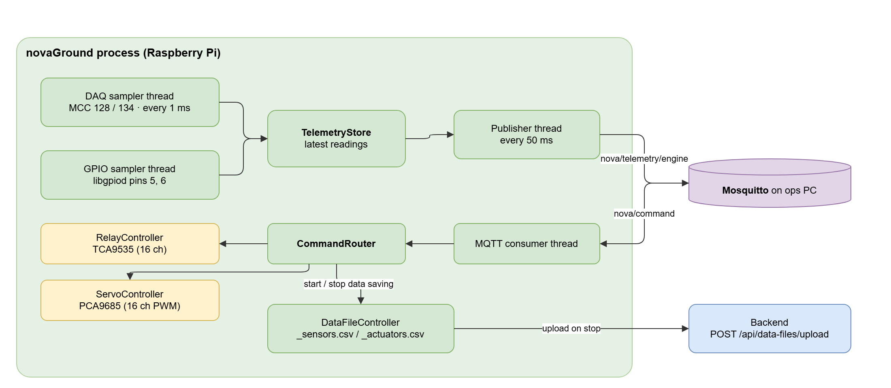
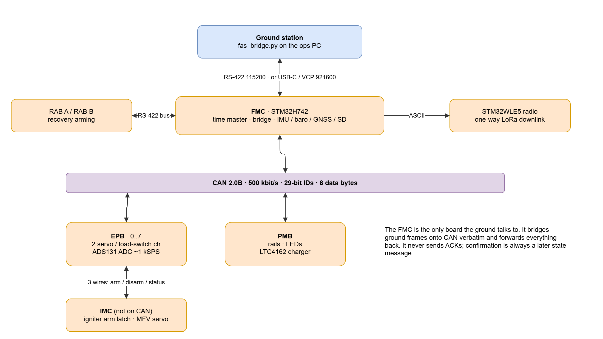
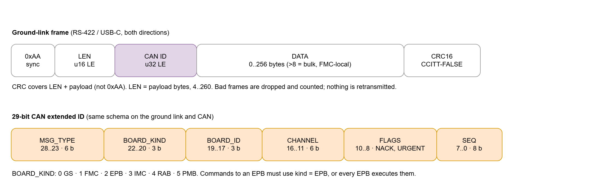

# System overview

What Nova is made of, where each piece runs, and how data moves between them.
For how the stack is run and updated, see [ops/README.md](../../ops/README.md)
and [RELEASING.md](../../RELEASING.md). The config model is in
[configs.md](configs.md).

## The pieces

| Component | Repo | Runs on | Language | Supervised by |
|---|---|---|---|---|
| novaOps backend | [novaOps-back](https://github.com/UTATRocketry/novaOps-back) | Ops PC, :8000 | Python 3.11+, FastAPI | WinSW service `nova-<env>-backend` |
| FAS bridge | novaOps-back `tools/fas_bridge.py` | Ops PC | Python, pyserial | WinSW service `nova-<env>-fas` |
| novaOps frontend | [novaOPS-front](https://github.com/UTATRocketry/novaOPS-front) | Ops PC, :3000 | TypeScript, Next.js 15, React 19, Chakra UI v3 | WinSW service `nova-<env>-frontend` |
| Nova Console | this repo, `ops/console/` | Ops PC, :8080 | Python (stdlib only) | WinSW service `nova-<env>-console` |
| MQTT broker | Mosquitto | Ops PC, :1883 | - | Windows service `mosquitto` |
| novaGround | [novaGround](https://github.com/UTATRocketry/novaGround) | Raspberry Pi 4 in the GSS | C++17, meson | systemd `novaGround.service` |
| FAS firmware | [Gigafloss-FAS-Firmware-and-Server](https://github.com/UTATRocketry/Gigafloss-FAS-Firmware-and-Server) | STM32 boards in the rocket | C | reference only |

The dev stack runs the same services on ports 8001 / 3001 / 8081 and never
starts on boot. Service names are in
[server-layout.md](server-layout.md#services).

## Network

All machines share one ethernet switch with static IPs, set in
`ops/nova.settings.ps1` (each machine's own copy of [ops/nova.settings.example.ps1](../../ops/nova.settings.example.ps1)):

| Host | Address |
|---|---|
| Ops PC ("Nova-Server") | 192.168.137.1 |
| novaGround Pi | 192.168.137.10 |
| novaThermo Pi | 192.168.137.20 |

The operator laptop needs no software. It opens the UI (`:3000`) and the Nova
Console (`:8080`) on the ops PC in a browser.

## Who owns what

- **novaGround** is the only software that touches the GSS hardware: MCC 128 and
  MCC 134 DAQ HATs, the TCA9535 I/O expander that drives the 16-channel relay
  board, the PCA9685 16-channel PWM servo driver, and Pi GPIO.
- **fas_bridge.py** is the only software that talks to the flight avionics. It
  connects to the FMC over RS-422 at 115200 baud and speaks the firmware's
  `rt_proto` frames. novaGround is not involved in the FAS path.
- **The backend** is the only thing that *publishes commands*. It owns the
  station config (`system.yaml`), client roles, the safety rules, the novaLock
  lockout state and recordings. It never touches hardware directly.
- **The frontend** renders what the backend sends and turns clicks into
  commands. It has no authority of its own: every command is checked by the
  backend.

## Data flow

**Telemetry (up).** novaGround samples the DAQ HATs every 1 ms and publishes
the latest readings every 50 ms on `nova/telemetry/engine`. The FAS bridge
publishes EPB ADC samples on the same topic and the full avionics state on
`nova/telemetry/flight`. The backend maps each `(source, hat_id, channel_id)`
to a sensor in `system.yaml`, applies calibration and a 5-sample rolling
average, drops readings that have not changed for 10 s (`NOVA_STALE_TTL_S`),
and broadcasts `engine_data` to every WebSocket client. Flight data is
forwarded unparsed as `flight_data`.

**Commands (down).** The UI sends `{type, name, state}` over the WebSocket (or
`POST /api/commands`). The backend checks the client's role, checks the
novaLock lockout for hazardous commands, resolves the actuator's binding from
config, and publishes on `nova/command`. novaGround executes GCS-bound
commands; the FAS bridge executes `type: "fas"` commands by encoding a frame
for the FMC.

Topic and message details: [api/mqtt-topics.md](../api/mqtt-topics.md) and
[api/backend-api.md](../api/backend-api.md).

## Safety model

> [!IMPORTANT]
> Software checks are only some of the layers. Nova can't fire the igniter:
> ignition is a separate launch controller, and the FAS firmware and IMC
> hardware enforce their own limits.

| Layer | What it does | Where |
|---|---|---|
| Roles | `viewer` (read only), `pad` (only `safetyRules.critical` commands), `operator`, `admin` (password `NOVA_ADMIN_PASSWORD`). pad, operator and admin are exclusive: one holder each. If the operator disconnects, the oldest viewer is promoted. | `app/services/role_service.py` |
| novaLock | A physical lockout that publishes `{"source":"novaLock","state":"locked"}` on `nova/control`. While locked, commands in `safetyRules.hazardous` and RAB arming are rejected. Can be overridden for testing with `POST /api/flags/lockout`. | `app/services/command_service.py` |
| Firmware | FAS boards validate every frame (CRC), the IMC latches arm/disarm in hardware, and the FMC reports true state instead of acknowledging. | firmware repo |
| Launch control | Ignition uses the stand-alone WilsonFX LCU-1W / PBU-4W, isolated from Nova entirely. | hardware |

## novaGround internals

novaGround builds three executables from one source tree (`meson.build`):

| Target | Sample | Publish | Use |
|---|---|---|---|
| `novaGround` | 1 ms | 50 ms | Main GSS Pi |
| `novaThermo` | 100 ms | 250 ms | Thermocouple Pi (MCC 134) |
| `novaMock` | 100 ms | 250 ms | No hardware; for development |

> [!NOTE]
> Missing hardware is detected at start-up and skipped, so novaGround keeps
> running in a degraded mode instead of exiting.

## Flight avionics (FAS)

Nova pins a compatible firmware commit for reference. The authoritative description is
[firmware/FMC-Interface-Contract.md](../../firmware/FMC-Interface-Contract.md).
The parts Nova depends on:

- The FMC is the only board the ground talks to. It bridges ground frames onto a
  500 kbit/s classic CAN 2.0B bus to the EPBs, PMB and IMC, and forwards their
  replies back verbatim.
- Ground links: RS-422 at 115200 (used by the ops PC), or USB-C / VCP at 921600.
- The FMC never sends ACKs. Confirm a command by watching the state message
  from the board that executed it.

> [!WARNING]
> `fas_bridge.py` re-implements `firmware/gs/protocol.py`; it doesn't import
> it. A protocol change in the firmware needs a matching change in the bridge
> ([procedure](../maintenance/update-the-firmware-reference.md)).

